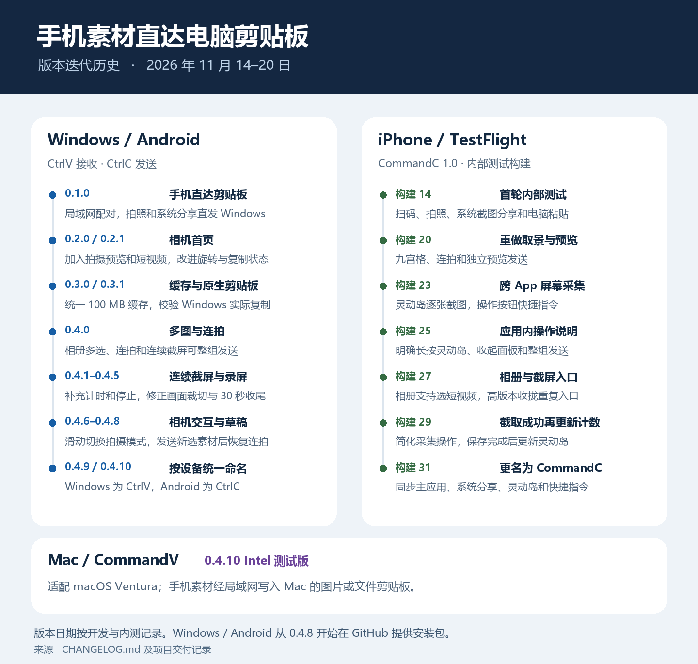

# 版本演进

按实际开发顺序说明每一步解决什么问题。推荐使用 **0.4.10**。0.4.8 是首次在 GitHub 发布安装包；早期版本是本地开发、安装或验证阶段，不代表当时已在 GitHub 发布，也不建议安装已知有问题的旧版。

## Apple 端 · 2026-11-20

- **CommandV 0.4.10 Intel 测试版**。增加 macOS Ventura 接收端，沿用局域网配对与传输协议。单图写入系统图片剪贴板，图集和视频写入文件剪贴板。已在 2017 Intel MacBook Pro 验证 iPhone 照片接收及跨应用粘贴。GitHub Intel 自动测试验证单图和 10 张有序文件剪贴板。测试包尚未完成 Apple 公证。
- **CommandC 1.0（31）**。TestFlight 内测从构建 14 的配对、拍照和系统分享，迭代到构建 20 的连拍，构建 23 的灵动岛截屏，构建 25 的「长按灵动岛」引导，构建 27 的相册视频和构建 29 的截取计数。构建 31 将主应用、系统分享、灵动岛和快捷指令统一为 CommandC。[iPhone 操作说明](docs/IOS.md)

## 0.1.0 · 2026-11-14 · 跑通手机到电脑

- 建立Windows托盘接收端与Android发送端。
- 扫码配对、默认电脑、局域网HTTPS、证书校验、mDNS发现。
- 拍照/系统图片分享 → 电脑剪贴板 → 用户Ctrl+V；非激活小预览。
- 请求去重，区分已接收与已复制。

先解决必须绕经微信文件传输助手的问题，以单图为主。

## 0.2.0 · 2026-11-14 · 首页变成相机

- 镜头风格图标、黑色相机首页、九宫格参考线。
- 短按拍照、长按录像、松手结束；预览、重拍和确认上传。
- 顶部显示电脑，未配置时扫码配对；视频以文件发到电脑。
- 这一阶段的时长和缓存策略，后续由0.3.0统一调整。

## 0.2.1 · 2026-11-14 · 兼容性与复制状态

- 修正Android API版本检查、旋转处理和构建路径。
- 增加剪贴板回读、重试及重新复制状态更新。
- 构建、静态检查和产物一致性通过；当时未单独完成全部安装实测，后续由0.3.x继续验收。

## 0.3.0 · 2026-11-14 · 100MB缓存与30秒上限

- 照片、视频、缩略图统一100MB，取消旧20项/24小时策略。
- 新素材先复制确认，旧素材后台按接收先后回收。
- 手机只存私有临时文件，成功/放弃后删除，重启清理遗留。
- 相机录像限制30秒，超限明确拒绝。

解决素材越积越多和长视频占用的问题。

## 0.3.1 · 2026-11-14 · 真正能粘贴才报成功

- Windows改用原生剪贴板序号及图片/文件格式回读校验。
- 锁屏、拒绝访问或写入失败不再误报已复制。
- Android沿用0.3.0，主要修改电脑端；解锁后的跨进程粘贴复验通过。

## 0.4.0 · 2026-11-14 · 图集、相册多选、连拍和连续截屏

- 每组最多10张独立图片，整组一次提交文件剪贴板。
- 相册多选、系统多图分享在确认选择后自动发送。
- 连续拍照收集整组，悬浮连续截屏不调用手机系统截图面板。
- 图集整组缓存和淘汰，保护当前剪贴板文件。
- Codex桌面端实测一次Ctrl+V出现01–10共十张独立图片。

## 0.4.1 · 2026-11-14 · 明确截屏操作，加入录屏

- 数字计数短条改为「截一张 / 录屏 / 查看图片」。
- 拖动提示、右上关闭、闪屏与缩略图反馈。
- 截图先回App预览/移除再发送；相册继续自动发送。
- 新增30秒无声录屏；早期控制与画面问题继续在后版修复。

## 0.4.2 · 2026-11-14 · 稳定取得静止页面

- 修正屏幕帧保留，减少「未取得屏幕画面」。
- 桌面与设置页连续截图、闪屏及预览通过实测。
- 受系统保护的相册画面不属于可绕过范围。

## 0.4.3 · 2026-11-14 · 录屏可见、可停止

- 增加计时浮窗和主动停止按钮，保留30秒自动停止与预览确认。
- 后续发现部分设备录屏只含屏幕左上区域，此版不作为推荐安装版本。

## 0.4.4 · 2026-11-14 · 修复录屏裁切

- 采集和编码使用对应屏幕尺寸，修复右侧/底部丢失。
- 调整编码码率，保留主动停止和30秒限制。
- 整屏文件、主动停止实测通过；预览拉伸和自动停止尾帧在下一版继续修正。

## 0.4.5 · 2026-11-14 · 录屏比例与30秒收尾

- 视频预览按原宽高比显示。
- 处理部分小米设备停止后的尾帧延长，后台无重编码收尾到30秒。
- 主动停止、30秒自动停止、确认上传、文件剪贴板、临时文件清理实测通过。
- 性能仍有波动，不承诺视频都在3秒内传完。

## 0.4.6 · 2026-11-15 · 相机布局与滑动切换

- 左边相册图标、中间快门、右边独立截屏/录屏。
- 拍摄/连拍分开，点击或左右滑动切换，带过渡动画。
- 当时为防素材覆盖，存在连拍草稿时锁住部分入口；0.4.8将其改为保留原组后允许进入。

## 0.4.7 · 2026-11-15 · 图集预览一键确认发送

- 大图预览右上直接「确认并发送」。
- 删除先下方确认、再右上发送、再弹窗的多余步骤。
- 取景仍先查看N张；忙碌时禁用重复提交，失败保留请求ID重试。

## 0.4.8 · 2026-11-15 · 连拍保留，新素材独立处理

- 连拍已有照片时相册、截屏/录屏入口仍可用。
- 原连拍保留，相册只发新选择，截图/录屏独立预览和发送。
- 待发入口可来回查看，取消选择不丢原图，完成当前项恢复原组。
- 成功只清理对应临时文件，其他待发组继续保留，电脑100MB规则不变。
- 27项自动化测试通过；安装后实测相册、截图、录屏、原连拍四次独立发送及原生剪贴板。

参考实测：小相册图0.3秒、截图1.3秒、17.75秒录屏4.3秒、两张连拍4.5秒。结果随设备和网络变化。0.4.8是当前GitHub推荐下载版本。

## 后续范围

iPhone App与分享扩展、跨公网传输、自动粘贴、多电脑同时接收尚未实现。待发素材属于当前会话，不是永久相册或云备份。

## 0.4.9 · 2026-11-17 · Android / Windows 改名 CtrlV

- Android 桌面名称、系统分享入口、采集通知与引导文案改为 CtrlV。
- Windows 窗口、托盘、快捷方式、安装包与内置 APK 改为 CtrlV。
- 沿用原 Android 包名和发行签名、Windows 安装身份与数据目录，保留原配对；开机启动改用新程序路径。
- APK 文件名为 `CtrlV-0.4.9-android-arm64.apk`，Windows 安装包为 `CtrlV-Setup-0.4.9.exe`。
- iPhone 版计划使用 CommandV；此次不包含 iOS 安装包或 App Store 上架。
- 拍摄、图集、截屏录屏、100 MB 混合缓存与 30 秒录制上限保持原行为。

## 0.4.10 · 2026-11-18 · 按设备统一命名

- Windows 接收端为 CtrlV，Android 手机端显示为 CtrlC，iPhone 为 CommandC，Mac 版预留 CommandV。
- Android 启动器、系统分享、截屏录屏提示和 APK 文件名同步更新。Windows 内置新版 CtrlC APK，安装身份与局域网配对沿用。
- iPhone 主应用、分享扩展、灵动岛及快捷指令显示 CommandC，保留原 Bundle ID 和共享 Keychain。
