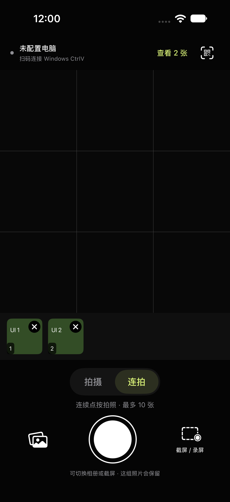
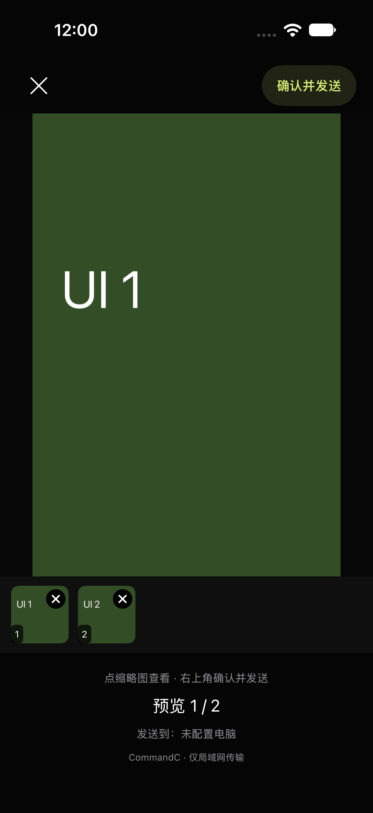
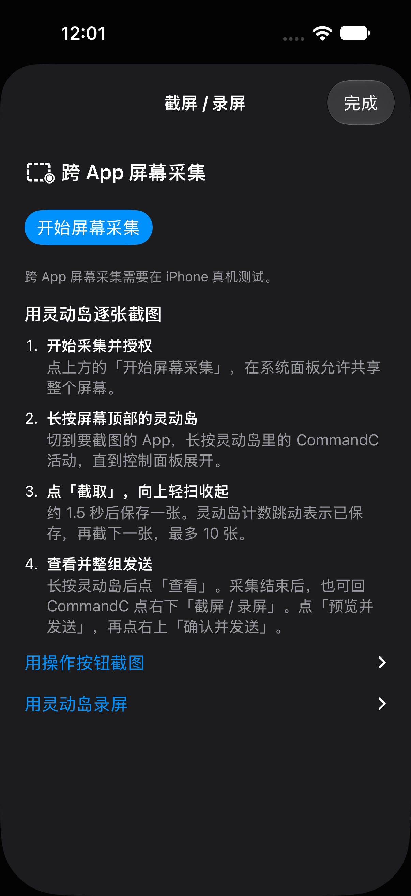

# 操作图库

截图展示各端的操作入口。安装和配对步骤见[项目首页](../../README.md)。

## Mac · CommandV

  
  

两个画面来自 2017 Intel MacBook Pro 上的 CommandV 0.4.10 测试版。左图显示配对入口，右图显示真实接收的单张照片与「已复制」状态。裁去了系统窗口边框，遮挡了电脑名称、局域网地址和测试照片缩略图。

## iPhone · CommandC

  
  
  

三张图来自与 TestFlight 1.0（31）使用相同 iPhone 源码的模拟器构建。图中的内容为演示素材。[iPhone 连拍与灵动岛操作](../IOS.md)

[查看四端版本迭代历史图](version-history.png)

## Windows 与 Android

| 图片 | 来源与处理 |
| --- | --- |
| `phone-camera.png` | 2026-11-16 Android 0.4.8 真机取景首页；裁去系统状态栏，遮挡配对电脑名称与局域网地址 |
| `phone-pairing.png` | 同一真机的「连接电脑」面板局部；遮挡设备信息，保留扫描入口和操作说明 |
| `phone-preview.png` | 同一真机新拍照片的实际预览；裁去系统状态栏，保留重拍与确认按钮 |
| `phone-confirm.png` | 同一真机的实际上传确认弹窗局部；遮挡目标电脑名称 |
| `desktop-pairing.png` | 使用未修改的 0.4.9 电脑端界面渲染，搭配演示设备名、地址和无配对权限的演示二维码 |
| `desktop-received.png` | 同一电脑端界面使用演示接收记录展示「已复制」状态；照片取自本次手机预览，不代表本轮新增传输测试 |
| `ai-paste.png` | 既有 Codex 多图粘贴实测截图，仅裁出输入框；保留真实附件显示，不包含侧栏和对话正文 |

用户明确选择使用本地裁剪、遮挡后公开。手机界面的按钮与文字没有生成式重绘；设备遮挡块属于文档隐私处理，不是软件本身的按钮。电脑截图用于公开展示，演示数据不会修改真实电脑的配对、接收记录或剪贴板。

配对时，请在自己的 CtrlV 或 CommandV 中点击「配对手机」，扫描当时生成的二维码。文档中的二维码用于演示。
